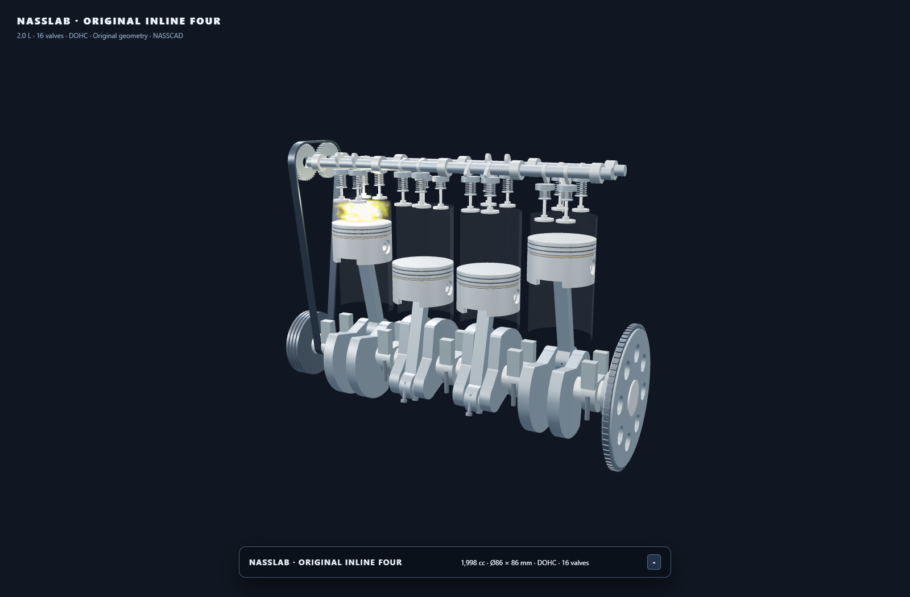

# NASSCAD

**Parametric 3D CAD in your browser or as a Windows desktop app, with local processing and no account.**

[Try NASSCAD](https://www.nasscad.com/) · [Download releases](https://github.com/Nx-Nass/NassCAD/releases) · [Report a bug](https://github.com/Nx-Nass/NassCAD/issues) · [Getting started](#getting-started)

Create solids, sketch in 2D, apply fillets and chamfers, and exchange STEP, IFC and mesh files. NASSCAD is a personal project by Nasser / NassLab. Personal, non-commercial and educational use is free under the terms in [LICENSE](LICENSE); commercial use requires an agreement.



*Four-cylinder engine created and animated with NassScript in NASSCAD.*

## Create with an AI assistant through NassScript

NassScript is a practical bridge between a language model and NASSCAD's live 3D scene. Give an assistant the [NassScript reference](https://www.nasscad.com/nasscript_doc.html), describe the part or mechanism you want, and ask it to draft a script. Review the JavaScript, then paste and run it in NASSCAD's integrated Script panel. You can refine the geometry, dimensions and motion by iterating on the script; NASSCAD processes the model locally.

The **[four-cylinder engine demo](https://www.nasscad.com/nasscript_doc.html#engine-demo)** shows the scope of this workflow: pistons, connecting rods, crankshaft, camshafts, timing belt and animation coordinated in one scene. [Explore the actual NassScript source](nass-demo-engine.js), or launch the demo from NASSCAD's welcome screen. AI assistance is optional; NASSCAD has no built-in LLM connection or AI account requirement.

## Which version should I use?

| Version | Best for | Requirements |
|---|---|---|
| [**4.7.0 — Windows desktop**](https://github.com/Nx-Nass/NassCAD/releases/latest) | Ready-to-run offline application with integrated MEDUSA | Windows x64; choose Setup or Portable in the latest release. No separate engine launcher is needed. |
| **4.7.0 — browser** | STEP / IFC, B-Rep fillets and chamfers | Modern browser and local HTTP server. Booleans work in the browser; **MEDUSA is optional for native multi-core processing and required for exact B-Rep STEP export.** |
| [**4.2.7 — classic**](https://github.com/Nx-Nass/NassCAD/releases/tag/v4.2.7) | The earlier self-contained HTML application | Browser; see the [original setup instructions](https://github.com/Nx-Nass/NassCAD/blob/v4.2.7/README.md). |

This is the canonical repository for NASSCAD. Versions are identified by tags and releases, rather than separate repository names. The histories of the former 4.2.7 and 4.7.0 repositories are retained.

## Getting started

For Windows x64, download **Setup** or **Portable** from the [latest release](https://github.com/Nx-Nass/NassCAD/releases/latest). Both packages include MEDUSA and start it with the application through an internal pipe. They include the illustrated manual and run locally without an account.

For the browser edition, clone the repository and serve its files over local HTTP:

```bash
git clone https://github.com/Nx-Nass/NassCAD.git
cd NassCAD
python -m http.server 8080
```

Open **http://localhost:8080/NASSCAD_V4_7_0.htm** in your browser. Keep the bundled files together. The current checkout includes the OpenCASCADE WASM and data files.

Union, Subtraction and Intersection work in the browser using the bundled Manifold WASM engine, loaded on the first boolean operation. For native multi-core booleans, large STEP assemblies and exact B-Rep STEP export, extract the build bundle for your platform and follow its instructions to build and start **MEDUSA**. See [the engine guide](#-nasscad-engine--medusa).

The release also provides a standalone MEDUSA engine package for browser users. The `DEPLOY_*` build bundles contain source and build instructions.

NASSCAD processes models locally. After downloading its components, it can run without an internet connection. A display of **1920×1080 or higher** is recommended.

---
## ✨ What's in 4.7.0

| | |
|---|---|
| **Watertight primitives** | ArcSphere, Cylind, Cubic, Tore, Gear, Screw, Nut, Pipe, RevSolid, Roof, Hollow box, Gen… |
| **Real fillet & chamfer** | True B-Rep operations via OpenCASCADE, on picked edges or all edges |
| **STEP AP203 / AP214 / AP242** | Import **and** export, with per-part *and* per-face colours read from the file itself |
| **PMI & GD&T** | Product manufacturing information read from STEP assemblies |
| **IFC — BIM read & write** | Opens IFC2X3 / IFC4 / IFC4X3 in the browser (bundled web-ifc engine, offline): every building element as its own object, with its IFC name, colour and real position in mm. Writes **IFC4** with the Project › Site › Building › Storey structure strict BIM software expects — cubes, cylinders, tubes, hollow boxes, spheres and cones as true parametric solids, everything else as triangulated surfaces, colours per face kept |
| **Non-destructive CSG tree** | Union / Subtraction / Intersection keep their construction tree — change a source and Re-run |
| **CSG engines** | Booleans use native, multi-core MEDUSA when available, or bundled Manifold WASM in the browser otherwise. The CSG panel identifies the active engine. MEDUSA supports progressive preview and full-quality results |
| **Build volume** | Your printer's bed and build volume on the grid — **28 best-selling printers** (Bambu Lab, Creality from the original Ender-3 and the Neo to the K2 Plus, Prusa, Elegoo, Anycubic, Voron, Sovol). Only the walls behind the part are drawn; a wall turns red when the part sticks out |
| **World grid** | A gridded room — floor, walls, ceiling — around your work, sized to the scene (1 m, 2 m, 5 m…) so depth and scale read at a glance. One button hides volume + room, the work grid stays |
| **Toolbox** | 6 icons per row. Scale the selection /5 /2 1× ×2 ×5 ×10, set the scroll-wheel zoom speed /5 /2 1× ×2 ×5 ×10 (remembered), measure, frame, drop to ground, centre of gravity… every button documented in the built-in help |
| **Sketch.Gen** | 2D sketcher |
| **Generators** | Screw.Gen & Nut.Gen (ISO / ASME, right- or left-hand thread, print clearance, Higbee cut), Gear.Gen, Pipe.Gen, CircularText.Gen |
| **NassScript** | Full-access JS console over the scene graph, with engine and solar-system demos |
| **Undo / Redo** | 200 levels, IndexedDB-persistent |
| **Editing** | Box-select, double-click cycle (resize handles → dimensions → rotation rings), X-Ray mode, magnetic snap down to 0.001 mm |
| **Import** | STL · OBJ · 3MF · GLB · PLY · STEP · IFC |
| **Export** | STL · OBJ · 3MF · GLB · PLY · STEP AP242 · IFC4 · SVG · DXF |

Requires a modern browser with WebGL and WebAssembly: Chrome 90+, Firefox 90+, Safari 16+.

---

## 🗂 Repository layout

```
NASSCAD_V4_7_0.htm          Application — the single entry point
three.js                    Renderer
nasscad-desktop.js          Desktop MEDUSA status and log panel
nasscad-medusa-bridge.js    Desktop internal-pipe transport for MEDUSA requests
nasscad-audit-fixes.js      Application fixes used by the published build
nasscad-object-range.js    Object range tools
nasscad-manifold-wasm.js    Browser boolean fallback
nasscad-fonts.js            Bundled typefaces
nasscad-draco.js            Draco codec (GLB/glTF)
nasscad-gens.js             Generators: Sketch, Screw, Nut, Gear, Pipe, CircularText
nasscad-io.js               Import / export pipeline
nasscad-materials.js        Material library
nasscad-buildvolume.js      Build volume (28 printers) and world grid
nasscad_logs.js             Structured logging
nasscad_occt_wasm.js        OCCT glue layer
nassscript.js               NassScript console
nasscript_doc.html          NassScript documentation
nasscad_user_manual.html    Illustrated user manual
NASSCAD_User_Manual_EN.pdf  Printable user manual
nass-demo-solar.js          NassScript solar-system demo
nass-demo-engine.js         NassScript engine demo
occt-import-js.js           occt-import-js bridge
occt-loader-b64.js          OCCT loader
opencascade.wasm.wasm       OpenCASCADE compiled to WebAssembly (66 MB)
opencascade.wasm.data.js    OpenCASCADE data file (88 MB)
quick-fillet.js             Fillet / chamfer (OCCT)
step-import.js              STEP reader
step-export.js              STEP AP242 writer
step-declare.js             STEP declarations
step-xcaf.js                XCAF — colours, PMI, assembly structure
ifc-import.js               IFC reader (web-ifc, in the browser)
ifc-export.js               IFC4 writer
web-ifc-api-iife.js         web-ifc engine
nasscad-ifc-wasm.js         web-ifc WebAssembly, embedded
web-ifc-LICENSE.md          web-ifc license (MPL 2.0)
MEDUSA_SOURCE/              MEDUSA engine — C++ source (nasscad_medusa.cpp)
DEPLOY_WINDOWS_11_MSVC/     Medusa_Engine_MSVC.zip — MEDUSA, MSVC build (source + CMake + vcpkg)
DEPLOY_UBUNTU_LINUX/        DEPLOY_UBUNTU.zip      — MEDUSA, native Ubuntu installer
DEPLOY_UBUNTU_WSL/          DEPLOY_UBUNTU_WSL.zip  — MEDUSA, WSL deployment
```

---

## 🐙 NASSCAD Engine — MEDUSA

**Optional for boolean operations in the browser; integrated in the Windows desktop packages.** NASSCAD probes MEDUSA before each operation and uses its native engine when available (`POST /csg` for a flat operation, `POST /csgtree` for a whole tree). Otherwise it loads `nasscad-manifold-wasm.js` on demand and performs the operation locally in a browser worker. The Windows desktop app transports these requests over an internal pipe. The CSG panel shows **Manifold C++ · MEDUSA** or **Manifold WASM**. Browser processing uses one core and is slower on large models.

MEDUSA is a small native binary that runs **on your own machine** and listens only to it — nothing is uploaded, no account, no remote server. It links Manifold in native C++ with oneTBB, so booleans run at compiled-native speed across your cores instead of single-threaded WASM, and it also does native STEP reading and tessellation.

**Works without MEDUSA in a browser** — viewing, primitives, selection, gizmos, fillet and chamfer, build volume, boolean operations, browser STEP import, IFC and mesh I/O. Keep the bundled files together; browser STEP import has limitations on large assemblies and per-face colors.

**Needs MEDUSA** — exact B-Rep STEP export. MEDUSA also provides native multi-core booleans and large-assembly STEP import.

**23/09/2026 fix** — mesh welding by proximity now probes neighbouring cells by integer index. Spheres centred on a plane at 0 (Z = 0) used to keep one unwelded seam vertex and fail as *NotManifold*; they now union cleanly. The source in all three `DEPLOY_*` bundles carries the fix.

**Engine log — on demand, not on disk.** MEDUSA writes no log file. The last 20 000 lines are kept in memory and served as plain text by `GET /log?n=<max>` — the jellyfish button in the NASSCAD Logs panel pulls them into the panel, next to the browser-side log of the same session. Pass `--logfile` to also write a timestamped `medusa-logs-<date>.txt`, as earlier builds did.

The C++ source is readable in [`MEDUSA_SOURCE/`](MEDUSA_SOURCE/). Build bundles are zipped in the `DEPLOY_*` folders — extract the one for your platform:

| Target | Zip | Contents |
|--------|-----|----------|
| `DEPLOY_WINDOWS_11_MSVC` | `Medusa_Engine_MSVC.zip` | `nasscad_medusa.cpp`, `CMakeLists.txt`, `vcpkg.json`, `build_msvc.bat`, `BUILD.md` |
| `DEPLOY_UBUNTU_LINUX` | `DEPLOY_UBUNTU.zip` | `install-linux.sh`, `nasscad.sh`, desktop launcher + icons, `README-LINUX.md` |
| `DEPLOY_UBUNTU_WSL` | `DEPLOY_UBUNTU_WSL.zip` | `deploy.bat` / `deploy.sh`, `Medusa_Engine_3.1.bat`, uninstallers |

---

## 📦 Third-party components — all local, zero CDN

**In the browser**

| Component | Author | License |
|-----------|--------|---------|
| `three.js` r128 | three.js authors | MIT |
| `manifold-3d` 3.5.4 (bundled WASM) | Emmett Lalish and contributors | Apache 2.0 |
| OpenCASCADE Technology 7.4.0 via opencascade.js 1.1.1 | Open Cascade SAS / Sebastian Alff | LGPL 2.1 with exception |
| `occt-import-js` | Viktor Kovács | LGPL 2.1 |
| `web-ifc` 0.0.77 | That Open Company | MPL 2.0 |
| Acorn 8.17.0 (bundled in NassScript) | Marijn Haverbeke, Ingvar Stepanyan and contributors | MIT |
| Draco 1.5.7 | Google | Apache 2.0 |
| `helvetiker` regular / bold | MAGENTA Ltd — MgOpen Modata | MgOpen License |
| `optimer` regular / bold | MAGENTA Ltd — MgOpen Cosmetica | MgOpen License |
| `gentilis` regular / bold | J. Victor Gaultney / SIL International | SIL OFL 1.1 |
| `nasscad_logs.js` | NassLab | CC BY-NC 4.0 |

**In the NASSCAD Engine companion**

| Component | Author | License |
|-----------|--------|---------|
| OpenCASCADE Technology 8.0.1 | Open Cascade SAS | LGPL 2.1 with exception |
| Manifold 3.5.3 | Emmett Lalish and contributors | Apache 2.0 |
| oneTBB 2022.2.0 | Intel / UXL Foundation | Apache 2.0 |
| Clipper2 1.5.4 | Angus Johnson | Boost Software License 1.0 |
| hwloc 2.11.2 | Inria and the Open MPI project | BSD 3-Clause |

Each third-party component stays under its own license. See [`THIRD-PARTY.md`](THIRD-PARTY.md).

---

## 👥 Authors

| Role | |
|------|-|
| **Architect & Tester** | **Nasser** — NassLab, Marseille, France. Vision, direction, critical bug identification, quality standards, field testing, technology pivots. |
| **Developer** | **Claude** — Anthropic. Native CSG engine, watertight primitives, STEP colour decoding verified against the file itself, surgical patches, systematic verification before delivery. |

---

## 📄 License

© 2026 NassLab — Nasser, France

NassLab's own code is distributed under the **Creative Commons BY-NC 4.0** license:

- **Education license — free of charge** — schools (secondary, technical and vocational), their teachers and students, public or private, as well as apprenticeship and training centres, colleges, universities, associations, FabLabs, makerspaces and libraries, may use, install, share and adapt NASSCAD for teaching, learning and research, including in paid training. No registration, nothing to sign. Students and teachers own the models they create. (Additional permission in [`LICENSE`](LICENSE).)
- **Personal and non-commercial use** — free, redistribution allowed with attribution
- **Commercial use** — written agreement required from NassLab

NASSCAD is a personal project, developed by one person on his own time. It doesn't earn its author a single cent.

[Full license →](https://creativecommons.org/licenses/by-nc/4.0/) · [`LICENSE`](LICENSE)

Third-party components listed above are **not** covered by CC BY-NC 4.0 and remain under their respective licenses.

> No implied warranty. The author cannot be held liable for any damage resulting from the use of this software.

---

*NASSCAD — NassLab · Marseille, 2026*
